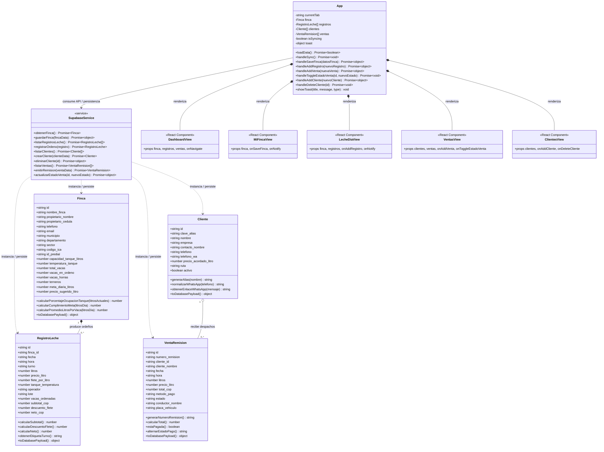

# Diagrama de Clases UML y Arquitectura de React — Leiti.app

Este documento presenta el **Diagrama de Clases UML** y la **Arquitectura en Capas de React** acorde al código fuente del proyecto (`src/models/`, `src/services/`, `src/views/` y `src/components/`).

---

## 1. Diagrama de Clases UML (Acorde al Código)

---

## 2. Explicación de las Relaciones del Diagrama

1. **Composición (`Finca "1" *-- "0..*" RegistroLeche`)**:
   - Una `Finca` produce múltiples registros diarios de ordeño (`RegistroLeche`). Cada pesaje pertenece a la unidad productiva y alimenta el nivel del tanque de enfriamiento.
2. **Agregación (`Cliente "1" o-- "0..*" VentaRemision`)**:
   - Un `Cliente` (planta procesadora, quesera o cooperativa) está asociado a cero o muchas remisiones de venta (`VentaRemision`), pero el cliente existe independientemente de si hoy hubo despacho o no.
3. **Dependencia / Servicio (`SupabaseService ..> Modelos`)**:
   - La clase estática `SupabaseService` (`src/services/supabaseService.js`) actúa como capa de acceso a datos (DAO/Repository), transformando las filas JSON de PostgreSQL (Supabase) en instancias de `Finca`, `RegistroLeche`, `Cliente` y `VentaRemision`.
4. **Arquitectura de Componentes en React (`App *-- Views`)**:
   - `App.jsx` centraliza el estado global (`useState`) y el ciclo de vida (`useEffect`), pasando datos y callbacks hacia abajo mediante `props` (flujo de datos unidireccional de React).
