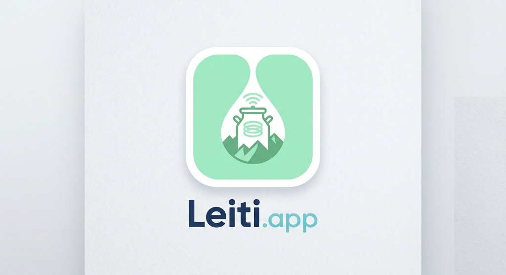
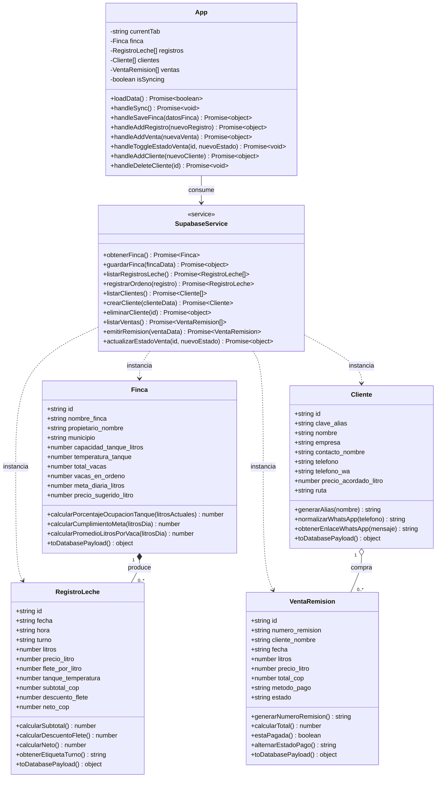

# Leiti.app — Sistema de Gestión Ganadera y Control Lechero

<p align="center">
  
</p>

Aplicación web desarrollada con **React 18**, **Programación Orientada a Objetos (ES6 Classes)**, **Tailwind CSS / CSS3** y conectada en tiempo real a **Supabase PostgreSQL**.

### Integrantes del Proyecto
- **Tomas Alejandro Garcia Benavides**
- **Angel Daniel Cortes Garcia**
- **Dilan Santiago Correa Gelves**

### Enlaces Oficiales del Proyecto
- **Aplicación en Vivo (GitHub Pages)**: [https://heladeriakreisel.github.io/leiti-app/](https://heladeriakreisel.github.io/leiti-app/)
- **Repositorio GitHub**: [https://github.com/HeladeriaKreisel/leiti-app](https://github.com/HeladeriaKreisel/leiti-app)
- **Base de Datos Supabase (PostgreSQL)**: Proyecto `leitti.appproyect` (`https://cthvxtjwstyezwzuohdx.supabase.co`)

---

## 1. Estructura y Arquitectura de React

El proyecto sigue una arquitectura modular por capas dentro de `src/`:

```text
proyecto-leitti/
├── index.html                      # Entrada principal lista para producción y navegador
├── app.html                        # Aplicación SPA conectada a Supabase vía REST/React
├── DIAGRAMA_CLASES.md              # Documentación detallada del Diagrama de Clases UML
├── supabase_schema.sql             # Script DDL PostgreSQL (Tablas, Vistas, Triggers y RLS)
├── src/
│   ├── main.jsx                    # Punto de montaje ReactDOM.createRoot
│   ├── App.jsx                     # Componente raíz (Estado global, Hooks y Enrutamiento)
│   ├── styles/
│   │   └── index.css               # Variables CSS (:root), animaciones y estilos base
│   ├── models/                     # Clases de Dominio POO (Acordes al Diagrama de Clases)
│   │   ├── Finca.js                # Clase Finca (cálculo de tanque, meta diaria, promedio/vaca)
│   │   ├── RegistroLeche.js        # Clase RegistroLeche (subtotal, flete, valor neto)
│   │   ├── Cliente.js              # Clase Cliente (alias, normalización WhatsApp, tarifas)
│   │   ├── VentaRemision.js        # Clase VentaRemision (cálculo total, estado de pago)
│   │   └── index.js                # Barril de exportación de modelos
│   ├── services/
│   │   └── supabaseService.js      # Clase SupabaseService (CRUD asíncrono con PostgreSQL)
│   ├── lib/
│   │   └── supabase.js             # Configuración del cliente Supabase y variables de entorno
│   ├── components/                 # Componentes UI reutilizables
│   │   ├── Sidebar.jsx             # Navegación lateral e indicador de estado PostgreSQL
│   │   ├── Header.jsx              # Barra superior con botón de sincronización en tiempo real
│   │   └── Toast.jsx               # Sistema de notificaciones flotantes
│   └── views/                      # Vistas principales del sistema
│       ├── DashboardView.jsx       # Panel de control, KPIs y gráfica de producción
│       ├── MiFincaView.jsx         # Configuración del predio, tanque y hato ganadero
│       ├── LecheDiaView.jsx        # Registro y liquidación de ordeños (Mañana / Tarde)
│       ├── VentasView.jsx          # Emisión de remisiones de venta e integración WhatsApp
│       └── ClientesView.jsx        # Directorio CRUD de compradores y plantas lácteas
```

---

## 2. Diagrama de Clases UML (Acorde al Código)



---

## 3. Modelo de Base de Datos en Supabase (PostgreSQL)

El backend utiliza 4 tablas relacionales en el esquema `public` con políticas **Row Level Security (RLS)** habilitadas:
1. **`public.fincas`**: Datos del predio, propietario, capacidad del tanque de frío e inventario del hato.
2. **`public.registros_leche`**: Pesajes diarios por turno (`morning` / `afternoon`) con columnas calculadas automáticamente en PostgreSQL (`subtotal_cop`, `descuento_flete`, `neto_cop`).
3. **`public.clientes`**: Directorio de plantas lácteas, queseras y cooperativas con precio pactado por litro.
4. **`public.ventas_remisiones`**: Despachos comerciales vinculados a los clientes y control de cartera (`paid` / `pending`).
5. **`public.vista_resumen_hoy`**: Vista SQL (`SECURITY INVOKER`) que consolida los indicadores diarios en tiempo real.

---

## 4. Ejecución Local

1. **En Visual Studio Code**: Presiona `Ctrl + Shift + B` o ejecuta `iniciar_servidor.bat` para abrir `http://localhost:3000/app.html`.
2. **Con Node.js / Vite**:
   ```bash
   npm install
   npm run dev
   ```
